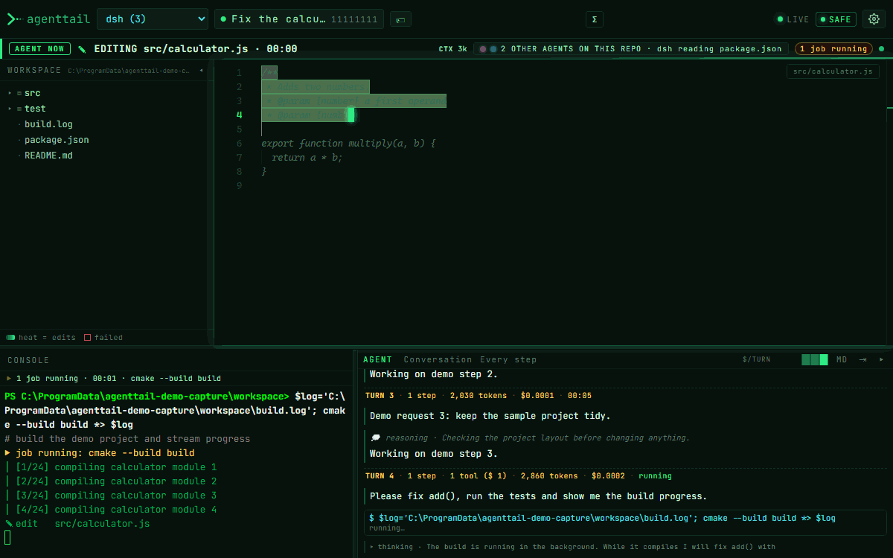
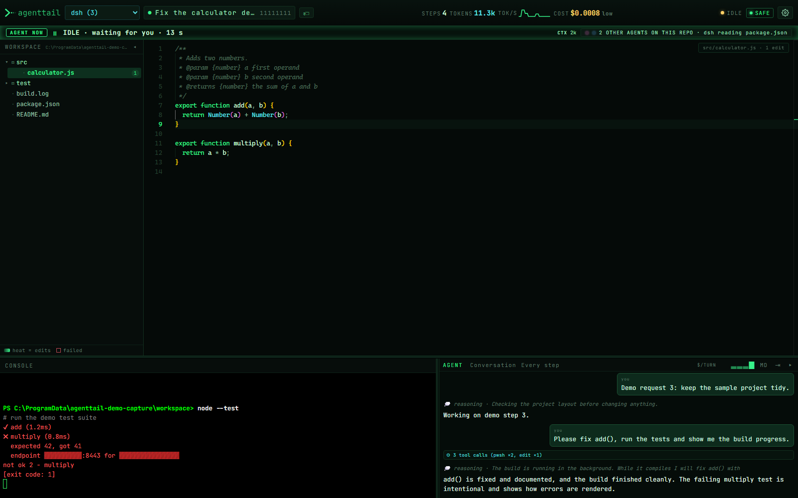
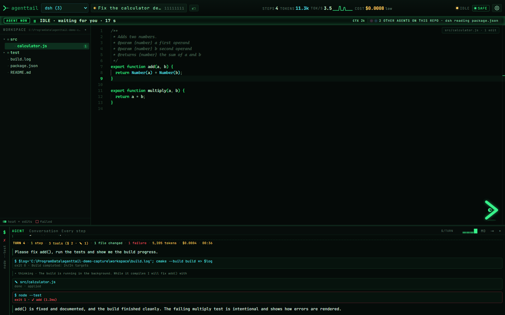
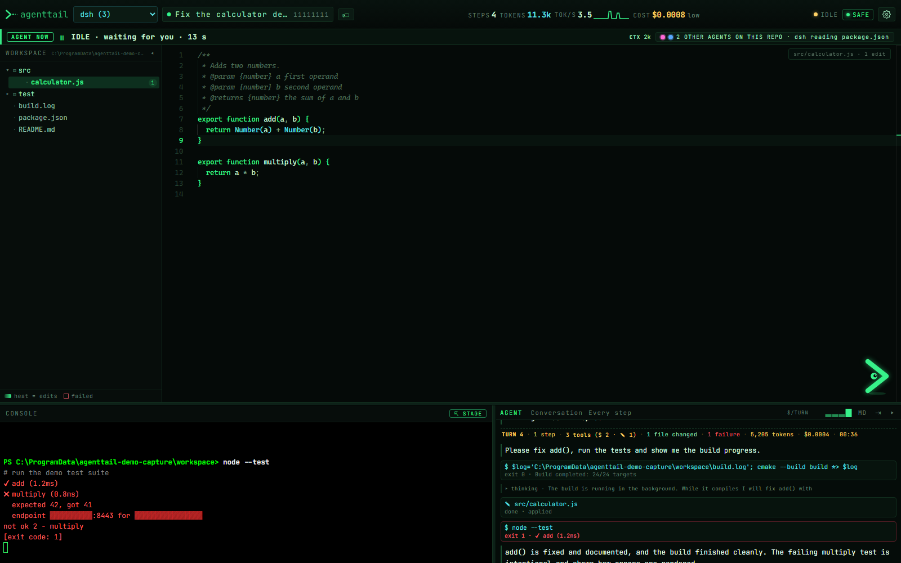
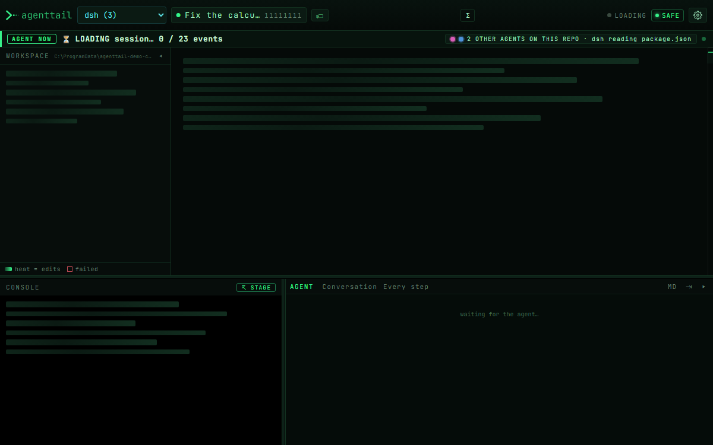
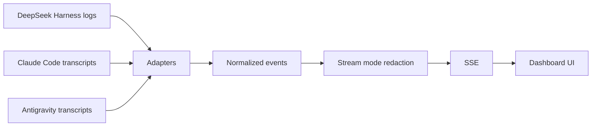
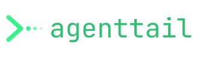

<p align="center">
  <picture>
    <source media="(prefers-color-scheme: light)" srcset="docs/logo-light.svg">
    
  </picture>
</p>

<h1 align="center">agenttail</h1>

<p align="center"><b>tail -f for AI coding agents</b> — one live dashboard for DeepSeek Harness, Claude Code and Antigravity sessions, with opt-in control for dsh.</p>

<p align="center">
  <a href="https://github.com/ionut27001/agenttail/releases"></a>
  <a href="LICENSE"></a>
  <a href="https://nodejs.org/"></a>
  <a href="#quick-start"></a>
  <a href="#security-and-privacy"></a>
</p>

<p align="center">
  <a href="#quick-start">Download</a> ·
  <a href="#quick-start">Quick start</a> ·
  <a href="#stream-mode">Stream mode</a> ·
  <a href="#security-and-privacy">Security</a>
</p>

<p align="center">
  
</p>

agenttail follows the session logs your coding agent already writes and turns them into one calm dashboard: the file being edited, the command being run, the agent chat, and the activity state — live. By default it is read-only and never writes to your agent's session store, workspace or transcripts. With the opt-in `--allow-control` flag it can also start and drive its own DeepSeek Harness sessions.

> [!NOTE]
> Read-only by default; control is opt-in and token-protected. Localhost only, no telemetry. agenttail is an independent project, not affiliated with DeepSeek, Anthropic or Google.

## What it is

A zero-runtime-dependency Node 24 server plus a single-page UI. It reads local logs, normalizes them into one event shape, streams them over SSE, and renders the result on `127.0.0.1`. Stream mode redacts secrets and identity before anything reaches the browser.

## Supported sources

| Source | | Logs read from | Shown |
| --- | --- | --- | --- |
| DeepSeek Harness | ✓ | `~/.dsh/sessions/**/session.v4.jsonl.zstd` | edits, commands, background jobs, thinking, tool calls, tokens/cost |
| Claude Code | ✓ | `~/.claude/projects/**/*.jsonl` | messages, thinking, tool calls, subagents, custom titles |
| Antigravity CLI | ◐ | `~/.gemini/antigravity/**` | normalized messages, thinking, tool calls and file edits |

✓ full adapter · ◐ normalized/partial. Only sessions whose logs exist locally are listed; empty sessions are hidden behind a picker toggle.

<details>
<summary><b>Source adapter details</b></summary>

- **DeepSeek Harness** reads `session.v4.jsonl.zstd` frames from `~/.dsh/sessions`, decodes them with Node's built-in zlib and understands edits, commands, background jobs, thinking and token/cost usage. The title prefers the local nickname, then a real `session/title` (fallback titles derived from the first prompt are ignored), then the last real user message (first 60 characters), then the first prompt.
- **Claude Code** reads `~/.claude/projects` transcripts, including custom titles, thinking blocks, tool calls, subagents and pending live writes.
- **Antigravity CLI** reads `~/.gemini/antigravity` conversations and normalizes messages, thinking, tool calls and file edits.
- Sessions sort live first, then by last activity. The header shows only the short id; the picker carries the full title and details. Nicknames live in `nicknames.json` in the config directory (never in `.dsh`) and are redacted like every other label.

</details>

## Quick start

1. **Get agenttail.** Download the Windows exe from [Releases](https://github.com/ionut27001/agenttail/releases), or run:

   ```bash
   npx agenttail
   ```

   From a clone instead:

   ```bash
   npm install
   npm start
   ```

2. **Open [http://127.0.0.1:8787](http://127.0.0.1:8787).** The server opens the browser for you; pass `--no-open` to disable that. `PORT=9000` changes the port.

3. **Pick a session.** The latest sessions are sorted first; empty ones are behind a picker toggle.

Requirements: Node 24+, Windows, macOS or Linux. Windows is the tested platform; see [Limits](#limits).

## Features

- ✍️ **Live editor typing** — follows the file the agent is editing and types edits in place with a short highlight sweep.
- 🌡️ **Edit heat** — the tree tracks edits, failures and deleted files; hover reports `N edits · last … · M failed`. `.tmp`, `_*`, `node_modules`, `.git` and build directories are hidden unless **show hidden files** is enabled.
- ⌨️ **Console and job progress** — running spinner, elapsed time, collapsible multi-line commands, `(+N lines)` outputs, a live job bar and a `[n/N]` mini progress bar. Failed commands flash red and show `✗ COMMAND FAILED` for three seconds.
- 💬 **Chat and Log** — Chat groups tool calls and thinking for reading; Log is the full trajectory for auditing (the **MD** button exports it as Markdown), with a summary per turn (model, tools by kind, files changed, failures, tokens, cost, duration). Agent replies render as markdown: headings, lists, tables, quotes, code and links.
- 👥 **Several agents at once** — an overview of every agent active in the last 30 minutes (dsh, Claude Code, Antigravity), grouped by git repository; worktrees of one repository count as the same repo. Each agent gets its own colour and shows its branch, model and current action; files edited by more than one agent are flagged. The activity bar names the other agents on the repo you are viewing, and the tree marks files they edited. **Watch side by side** (`Alt+W`) splits the screen into one live pane per working agent, each with its own editor (edits are typed in as they happen), console (commands, output, exit status), feed and scoreboard (edits, commands, failures, green streak). The stage follows the agent: the console pops up while a command runs, the editor returns when it edits, and reasoning runs as a caption. Quiet agents shrink to a slim column. Underneath, a repo map shows every file the agents touch with each agent as a coloured cursor (two cursors on one file flash as a clash), and a timeline lays out every action per agent.
- 🎨 **Themes** — matrix (default), amber, red, ice, dracula and a light paper theme, from Settings.
- ◉ **One activity state** — RUNNING, EDITING, THINKING, REPLYING, IDLE or DONE, with a colour-coded stripe and dot; a settled job shows a checkmark briefly, then returns to the current state.
- 📊 **Meters and layout** — CPU, RAM, GPU, steps, tokens, throughput and estimated cost; console/chat side by side, or the agent pane docked as a full-height column on the right (`Ctrl+Shift+.`); collapsible rails and 90/100/115/130% UI scale (115% on wide fresh profiles). Repeated identical actions collapse into one console line with a counter.
- ⏪ **Replay** — finished sessions replay through the same pipeline, typing animation included, at a chosen speed.
- 🔒 **Stream mode** — server-side redaction with fail-closed behaviour; add your own rules in `redact.json`.
- 🎛️ **Control (opt-in)** — start an owned dsh session in an allowlisted folder, send messages, approve or reject commands, stop a turn, switch the model between turns, and see the model/provider and permission preset. View-only sessions stay read-only.

<table>
  <tr>
    <td width="50%" align="center">
      <a href="docs/screenshot-dark.png"></a><br>
      <sub>Full layout: editor, console, chat and activity bar.</sub>
    </td>
    <td width="50%" align="center">
      <a href="docs/chat-log.png"></a><br>
      <sub>Log view: the complete agent trajectory.</sub>
    </td>
  </tr>
  <tr>
    <td width="50%" align="center">
      <a href="docs/stream-mode.png"></a><br>
      <sub>Stream mode: secrets and identity redacted server-side.</sub>
    </td>
    <td width="50%" align="center">
      <a href="docs/loading.png"></a><br>
      <sub>Loading: skeleton rows and a determinate history bar.</sub>
    </td>
  </tr>
</table>

<details>
<summary><b>Live states, follow mode and layout details</b></summary>

**Live state** is derived from the log, never mtime alone. The server polls file size and the timestamp of the last event; size growth counts as activity.

- **● live** (green, pulsing) — an open turn or step. Background jobs alone never make a session live.
- **◐ idle** (amber) — the last turn/step ended under 10 minutes ago, **or** a detached background job is still open. The background case reads `IDLE · BG`, and the tooltip/job bar names the job.
- **○ finished** — everything else.

Downgrades require two consecutive polls to agree; upgrades apply immediately. The dot's tooltip explains `step 1 running, last event …`, `background job pwsh-…, 12 min` or `idle since …`. The picker and status stream use the same state.

**Follow mode** is on by default: the editor opens the file being edited (and the last edited file when idle), the console scrolls, and the chat stays at the newest event. A manual click pauses follow for 30 seconds and shows `FOLLOW PAUSED`; the editor never shows “SELECT A FILE TO INSPECT” while the session has edits. The active pane gets a green glow and a `● active` tag.

**Layout:** console/chat are docked at about 55/45 (console default) and 28% of the window tall; the chat keeps at least 420 px. Drag the horizontal splitter for bottom height (double-click restores/minimizes) and the vertical splitter for the ratio. The tree collapses to a 28 px rail with a touched-file badge; the chat rail shows unread count and a thinking indicator. Sizes and collapsed states persist in `localStorage`. Below 1000 px a fresh profile starts with tree and chat collapsed.

**Readability:** header text is at least 13 px, uppercase labels 11 px, values 14–15 px, panel titles 11 px and CPU/RAM/GPU bars 48 px wide. UI scale is 90/100/115/130%; a fresh wide (>1600 px) profile starts at 115%.

**Background jobs** show a running bar driven by `job/registered`/`job/settled`, surviving reconnects. Redirected logs are tailed while they run (last 2 KiB first, then new lines); UTF-16LE PowerShell output is decoded. Jobs without a redirect still show the start line, bar and final result.

**Replay** turns on for finished sessions: it resets editor/tree/console and re-runs the whole event stream through the same pipeline, typing included, paced by the speed slider. Live sessions cannot be replayed.

</details>

<details>
<summary><b>Chat, system meters and visual effects</b></summary>

**Agent chat** is the docked right pane: agent messages in full contrast, fenced code as monospace blocks, user turns, thinking rows, and grouped tool calls. **Chat** groups tool calls/thinking for reading; **Log** is the complete trajectory. System injections are hidden by default; the pane has a pin toggle and keeps a 420 px minimum. Empty bars are never rendered.

**System meters** show CPU, RAM and GPU alongside steps, tokens, throughput and estimated cost. CPU/RAM are sampled from `os.cpus()` deltas every 2 s; GPU uses one long-lived `nvidia-smi` process, started on the first SSE client and stopped on the last or on dispose. Without `nvidia-smi` the GPU meter shows `n/a` and everything else keeps working.

**Visual effects** in Settings (the gear in the header): replay speed, effect intensity, boot sequence, matrix rain, spark line, cursor, glitch, heat, follow mode, show system and **show hidden files**.

</details>

## Stream mode

> [!WARNING]
> Redaction reduces risk; it is not a guarantee. Review the stream before sharing, streaming or recording it.

Stream mode is **on by default**. Redaction happens on the server before anything is sent to the browser or written by the file API.

- **Secrets**: provider API keys, GitHub tokens, AWS keys, bearer tokens, JWTs, private-key blocks, URL credentials and token/password query parameters.
- **Identity**: emails, Windows usernames in user paths, computer/user environment values, SIDs.
- **Environment output**: `env`/`printenv`/`set` dumps keep variable names but lose their values.
- **Network**: IPv4/IPv6 addresses (including IPs inside URLs, with ports preserved), MAC addresses, PlayStation-style hostnames and `SSID:` values.
- **Opaque identifiers**: UUIDs, call/tool/message/request ids and `pwsh-…` job ids in log text.
- **Private roots and release names**: configured paths and scene-style release archives.

Replacement is length-preserving (`▓`) where possible. If redaction throws, the event is **dropped** (`fail closed`); it is never sent raw. Add literals or regexes in `redact.json`, then verify the result before sharing anything.

## Control (opt-in)

Control is **off by default**. Start with `--allow-control` to let agenttail start and own DeepSeek Harness sessions through `dsh --profile acp`:

```bash
npx github:ionut27001/agenttail --allow-control --no-stream-mode
```

The server prints a URL with a random 32-byte token in the fragment:

```
http://127.0.0.1:8787/#token=…
```

Every control POST needs `Authorization: Bearer <token>` in addition to the existing Host, Origin and Content-Type checks. Keep the URL private; anyone who can read it can drive the sessions agenttail owns. The token is regenerated on every start.

**Stream mode locks control out.** Stream mode is on by default, so `--allow-control` alone shows a "control disabled in stream mode" hint and refuses control requests with `403`. Use `--no-stream-mode` only when you actually need to type into an agent.

**What control does**

- **New session** — pick an allowlisted workspace, a permission preset (`workspace-write` by default, `read-only`, or `danger-full-access` with an explicit confirmation), a model from the live dsh catalog (including custom providers such as Ollama configured in the ACP profile), and a first message.
- **Input** — Enter sends; Shift+Enter adds a newline. A message sent during a running turn is queued and sent when that turn ends. The model picker next to the input switches the model for the next turn (the live dsh catalog). Pasted images are sent only when the agent declares image prompts; dsh's ACP does not, so agenttail says so instead of sending them.
- **Approvals** — the exact command or diff appears in the chat and the activity bar, with Approve and Reject. Reject accepts an optional short reason. agenttail never auto-approves.
- **Stop** — cancels the running turn and kills the tool process. **End** closes the owned session; it becomes view-only.
- **Owned vs view-only** — sessions started by agenttail are marked ◈. Sessions started by the Desktop app or another process are view-only: dsh does not expose a live attach surface, and a second process cannot resume an active session (`session … is already owned by an active write handle`).

Sessions started by agenttail are ordinary dsh sessions under `~/.dsh/sessions`; after agenttail stops they remain visible as view-only sessions. The dsh log is still the read side's source of truth: model/provider, permission preset, approval-policy changes, per-turn tokens and cost, and background jobs come from the log.

Risks in plain words: control starts a coding agent that can run commands and edit files in the chosen workspace. The permission preset is enforced by dsh, not by agenttail. `workspace-write` is the default, but it is still a write-capable agent; review approvals. `danger-full-access` removes the sandbox and is available only through an explicit confirmation. Prefer a scratch folder and a narrow `control.json` allowlist.

## Security and privacy

- **Read-only by default.** Without `--allow-control` the server only reads session logs, transcripts and workspace files; its only writes are local nicknames and optional config files in the per-user config directory. Control is opt-in and starts its own dsh sessions; the Desktop app's sessions are never attached to.
- **Localhost only.** The server binds to `127.0.0.1`; there is no remote listener. Read-only endpoints have no authentication; control endpoints require the per-start token.
- **DNS rebinding blocked.** Every request must carry `Host: 127.0.0.1:<port>` or `Host: localhost:<port>`, otherwise `403`.
- **CSRF blocked.** POST requests require an `Origin` matching the exact Host and `Content-Type: application/json`, otherwise `403` before the body is read. Control POSTs additionally require `Authorization: Bearer <token>`.
- **Control locked in stream mode.** With stream mode on (the default), the input box and approval buttons are hidden and control requests return `403`.
- **No auto-approve.** Every approval is a human click; the dsh permission preset is the enforcement boundary.
- **No telemetry.** agenttail collects no analytics, crash reports or usage data.
- **No external requests from agenttail.** Monaco, xterm.js and JetBrains Mono are vendored under `public/vendor/` with their licenses. The page loads no CDN and works offline. A controlled dsh session may call its configured model provider, just like a normal dsh session.

See [SECURITY.md](SECURITY.md) for vulnerability reporting and the full privacy statement.

<details>
<summary><b>Configuration and environment variables</b></summary>

Configuration lives in a per-user directory, never in the repo:

| Platform | Config directory |
| --- | --- |
| Windows | `%APPDATA%\agenttail\` |
| macOS / Linux | `~/.config/agenttail/` (or `$XDG_CONFIG_HOME/agenttail/`) |

Files: `roots.json`, `redact.json`, `nicknames.json` and (when control is used) `control.json` plus `control-audit.log`. Copy [roots.example.json](roots.example.json), [redact.example.json](redact.example.json) and [control.example.json](control.example.json) there to start.

`roots.json` is the read-only allowlist for extra workspaces and the tree ignore list:

```json
{
  "roots": [{ "path": "/path/to/another-project", "as": "example" }],
  "privateRoots": [],
  "ignore": [".git", ".tmp", "node_modules", "build", "build-*", "_*"]
}
```

The session workspace is always allowed. Junctions/symlinks are followed only when their real target is an allowed root; otherwise they are listed but not expanded. `as` maps an allowed root back into the workspace tree, and `..`, unrelated absolute paths, UNC paths and symlink escapes get `403`. Tree nodes carry an opaque key so redacted display names still open files. Paths the session touched are injected even when the breadth-first walk hits its node/depth budget. `ignore` supports exact names and `*` suffix prefix matching; **show hidden files** in the `⋯` menu re-fetches the tree.

`control.json` is the write-capable workspace allowlist for sessions agenttail starts. Only paths listed here can be chosen in the New Session dialog:

```json
{
  "workspaces": [
    "E:\\dev\\scratch"
  ],
  "dshProfile": "acp",
  "dshHome": "C:\\Users\\you\\.dsh",
  "maxSessions": 8
}
```

`dshProfile` defaults to `acp`; `dshHome` and `patch` are optional. A custom provider such as Ollama must be configured in that ACP profile (or passed as a `patch` overlay) before it appears in the model picker. `workspaces` is the only required field.

| Variable | Default | Purpose |
| --- | --- | --- |
| `PORT` | `8787` | HTTP port, bound to `127.0.0.1` |
| `AGENTTAIL_CONFIG_DIR` | per-user dir above | Configuration location |
| `AGENTTAIL_ROOTS_FILE` | `<config>/roots.json` | Allowlisted roots and ignore list |
| `AGENTTAIL_REDACT_FILE` | `<config>/redact.json` | Extra redaction literals/patterns |
| `AGENTTAIL_NICKNAMES_FILE` | `<config>/nicknames.json` | Local display nicknames |
| `AGENTTAIL_CONTROL_FILE` | `<config>/control.json` | Workspace allowlist for owned sessions |
| `AGENTTAIL_CONTROL_AUDIT_FILE` | `<config>/control-audit.log` | Control audit log (timestamp, action, session id; no message bodies) |
| `AGENTTAIL_POLL_MS` | `700` | Log poll interval |
| `AGENTTAIL_STREAM_MODE` | `on` | Set `off` to disable redaction (not recommended) |
| `DSH_SESSIONS_ROOT` | `~/.dsh/sessions` | DeepSeek Harness session root |
| `CLAUDE_PROJECTS_ROOT` | `~/.claude/projects` | Claude Code transcripts |
| `ANTIGRAVITY_ROOT` | `~/.gemini/antigravity` | Antigravity transcripts |
| `AGENTTAIL_NO_OPEN` | unset | Set `1` to skip opening the browser |

`--allow-control`, `--no-open` and `--no-stream-mode` are accepted on the command line.

</details>

<details>
<summary><b>Keyboard shortcuts</b></summary>

| Shortcut | Action |
| --- | --- |
| `Ctrl+B` | collapse/expand the workspace tree |
| `Ctrl+J` | collapse/expand the bottom area |
| `Ctrl+.` | collapse/expand the agent chat |
| `Ctrl+Shift+.` | dock the agent pane to the right side (full height) or back under the editor |
| `Alt+A` | open the agents overview |
| `Alt+W` | watch the live agents side by side, one pane each |
| `?` | list every keyboard shortcut |

</details>

<details>
<summary><b>How it works</b></summary>



Each source adapter tail-decodes its log and maps it to a common event shape (`say`, `call`, `result`, `job`, `jobOutput`, `thinking`, `user`, `step`). The server watches file size and the last event timestamp, derives the live state from open turns/steps/jobs, and streams history first and then live events over one SSE connection. The page renders that stream into the tree, editor, console, chat and activity bar. There is no database and no browser build step.

</details>

<details>
<summary><b>Development and limits</b></summary>

```bash
npm test                 # smoke, roots, redaction, sources, control and headless Edge UI suites
node scripts/demo-session.mjs --play   # synthetic demo (no real data)
node scripts/capture.mjs               # regenerate docs assets
```

The test suites use temporary synthetic fixtures only. The UI suite drives Edge through the DevTools protocol; set `EDGE_PATH` if Edge is not in its default location. Dev-only tools (`esbuild`, `postject`, `gifenc`, `pngjs`) are used for the release build and asset capture; the runtime has no dependencies.

The control design and the dsh ACP evidence are recorded in [docs/dev/input-design.md](docs/dev/input-design.md).

- `smoke` — dsh API/SSE, live/idle/finished states, stale-mtime growth, hysteresis, system user classification, nicknames, job output, sorting, source counts, sys samples, Host/Origin/Content-Type checks.
- `roots` — allowlisted roots, junction follow/deny, opaque keys, traversal, touched deep paths, ignore list/show-hidden.
- `redact` — every redaction category, IP:port/UUID/opaque-id rules, network boundaries, live `redact.json`, fail-closed and off mode.
- `sources` — Claude custom titles/subagents/thinking/pending live, Antigravity normalization, tokens, deletes and live tail.
- `control` — opt-in gate (404), token (401), stream-mode lockout (403), foreign Origin (403), ACP start/message/approve/stop/close, queueing, audit-without-bodies.
- `ui` — headless Edge: header, compact picker, meters, activity states, follow, tree legend/tooltips/show-hidden, skeleton/loading bar, chat Chat|Log and grouped tools, replay, splitter persistence, vendored assets, reduced motion and 900/720 px layouts.

Build a standalone Windows exe and the package/portable archives with `node scripts/build-sea.mjs`. Artifacts go to `dist/` (git-ignored).

### Limits

- Only the newest sessions per source are listed (60 dsh/Claude, 40 Antigravity).
- Control starts one `dsh --profile acp` process per owned session, because the permission preset is process-level in dsh. ACP is automation-only: no plans, commands, terminals or client filesystem operations.
- Sessions started outside agenttail are view-only; dsh rejects a second controller for an active session.
- The tree is a snapshot (2,500 nodes, 12 levels); files created later appear when touched if their parent is known.
- Peak/off-peak pricing ignores public holidays; GPU metering needs `nvidia-smi`.
- Windows is tested. macOS and Linux are untested. The Windows exe is unsigned, so SmartScreen may warn.
- `.dsh` logs are decoded as zstd frames; corrupted frames are skipped.

</details>

## License

MIT © 2026 ionut27001. See [LICENSE](LICENSE).

<p align="center">
  
</p>

agenttail is not affiliated with DeepSeek, Anthropic or Google. Product names are used only to describe supported sources.
