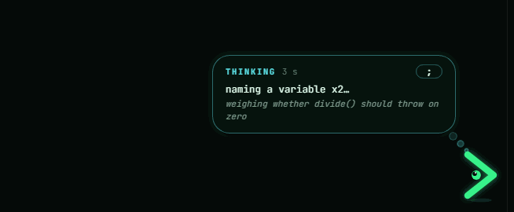
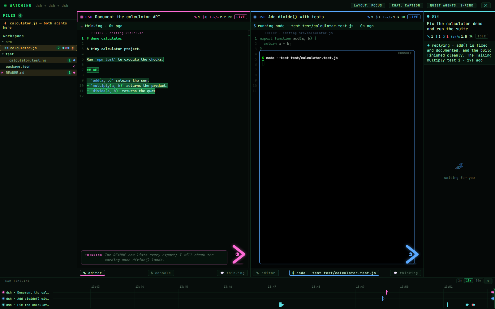

# Unreleased

- Needs you: every session shows when its agent is waiting on you, not just
  working or idle, with no flags. DeepSeek Harness sessions from their open
  approval prompts in the log; Claude Code from its own status files (status
  fields only, never the key files next to them, checked against the process
  start time) and from open questions or plan approvals in the transcript;
  owned sessions from their pending approvals; the Antigravity CLI from its
  own log while its process is alive (the editor's prompts stay invisible,
  and agenttail says so). It shows in the session picker, the agents
  overview, the watch wall (a pane that needs you never shrinks away), the
  tab title and favicon, and desktop notifications. An inbox (`Alt+I`) lists
  everything that needs you, with Approve and Reject in place for owned
  sessions. Idle sessions now read "ready".
- Antigravity: conversations of the Antigravity CLI, which keeps them in
  `~/.gemini/antigravity-cli`, are listed next to the editor's.
- Safer approvals: Approve always means "allow once" and never picks an
  agent's "always allow" option; cards show the command, paths and diff
  before the agent's own title; a card whose details change after you saw it
  must be seen again; a request with no details cannot be approved; pending
  approvals end with their turn and none is taken after Stop.
- Groundwork for driving more harnesses: a `harnesses` block in
  `control.json` (old files keep working), capabilities read from the agent
  instead of assumed, a mode picker, a stricter environment for harnesses
  other than dsh, the agent's error output shown when it fails, and a server
  that survives a misbehaving agent.
- A project site on GitHub Pages: a replayed session with the console on
  stage, Tail to pet and to play with, all ten games playing themselves in
  an arcade, the seven themes recolouring the page, and stream mode
  redacting a console. Tail, its bubble, the games and the themes are the
  app's own files, assembled by `scripts/build-site.mjs`.
- Theme colours and Tail's styles moved into their own stylesheets
  (`themes.css`, `tail.css`) so the app and the site share them.
- DeepSeek Harness: a run that crashed or was killed no longer stays live
  forever and sorts first. An open step or turn with no event for 30 minutes
  reads "stopped without ending its turn"; a long silent tool wait under that
  limit is still live. A turn that ended, cleanly or with an error, also ends
  its steps, and a new turn ends what an earlier one left open, so a failed run
  no longer reads as running; the list and the open session agree on it.
- DeepSeek Harness cost is now priced reply by reply from the provider and
  model that served it: `deepseek-flash` (and its old name `deepseek-v4-flash`)
  and `deepseek-v4-pro` at DeepSeek's published list prices; the signed-in
  `deepseek-account` route, Ollama and every other model show tokens only,
  where Ollama and MiniMax traffic used to be priced as DeepSeek. Compaction
  calls now count in tokens and cost. The figure is labelled a list-price
  estimate with the date of the price table, says "tokens only for ..." when
  part of a session had no price, and the session list shows the same number
  as the open session.
- DeepSeek Harness provider errors are no longer invisible: out of credit
  (HTTP 402), rate limits, timeouts, server errors and a missing sign-in show
  as a red chip in Chat and Log, a red line in the console and a `FAILED`
  activity bar, with a fixed wording and the HTTP status (never the provider's
  own message). The failure stays on the session until a later successful
  reply or a new turn clears it. Out of credit and a missing sign-in also
  count as "needs you" (`NEEDS YOU · out of credit`, `NEEDS YOU · sign-in
  needed`) for six hours.

---

# agenttail v0.3.0

**Meet Tail, the console on stage, and honest numbers for Claude Code.** The
logo's chevron grew an eye and moved into the editor: it reacts to what the
agent does, thinks out loud while the model thinks and plays games on a long
think. Still a local, read-only viewer by default.



## Highlights

**Tail, the mascot**

- Tail lives in the editor corner while a session is in motion. Its eye
  follows the pointer; it hops when a command passes, sweats when one fails,
  cheers when a turn ends, dozes off when nothing happens and likes being
  petted (not too fast). Settings can turn it off.
- While the agent thinks, three dots rise into a thought bubble with a clock,
  the latest line of reasoning and some nonsense (catching kittens, what is
  42). Five quiet minutes and it falls asleep under a STALLED? warning.
- On a long think it plays one of ten games by itself: snake, tetris, a
  runner, chess (two famous games replayed), chomp, space invaders, a
  geometry-dash level with ship sections, breakout, flappy and a shell-command
  typing game. ▶ play hands you the controls (arrows and space; Esc gives
  them back, N for the next game), and the best score per game is kept.
- The logo is Tail now, in the README, the favicon, the wordmark and the boot
  banner.

**Console on stage**

- The new default: a running command brings the console up over the editor,
  an edit sends it back to its dock, and a quiet console shrinks to a rail so
  the agent pane gets the room. The console header switches back to the plain
  docked console.

**Claude Code**

- A cost for Claude sessions: what the same tokens would cost at Anthropic's
  API list prices, each reply priced by its own model, with cache reads,
  5-minute and 1-hour cache writes, Haiku 5.5's long-prompt rate card, Opus
  5.5 fast mode and web searches. It is labelled ≈ API: a subscription is not
  billed per token, so it is a yardstick, not your bill.
- Token and step counts were about 2.5× too high: the transcript repeats a
  reply's usage on every content-block line, and each reply now counts once.
- Claude sessions get turns, from a real prompt to end_turn or an interrupt,
  so the Log shows per-turn summaries and costs. The header names the model.
- A session stays live while the model composes a long reply: a turn is open
  until the transcript says end_turn, not just while the file grows.

**Watch wall**

- Every pane gets its own Tail in its agent's colour, reacting to that agent,
  with the thought bubble and the games (▶ play works there too; Esc ends the
  game before it closes the wall).
- The pane scoreboard shows TOK/S.

**Everywhere**

- TOK/S shows a number: output tokens per second over the last 30 seconds.
- Themes: red redrawn as crimson and bone, a new neon (synthwave) theme, a
  separate success colour so success never looks like the accent or an error,
  and editor bracket pairs in each theme's own colours. Seven in all.
- A very long running command no longer pushes the page wider than the window.
- The README has a Meet Tail section, a themes mosaic and fresh captures.

## Compatibility

- Same Node 24+ requirement and log locations. Nothing to migrate.
- Claude token and step totals drop for existing sessions: that is the
  double counting going away, not lost data.

---

# agenttail v0.2.0

**Watch several agents at once, opt-in control for DeepSeek Harness, and a
deeper read side.** The default is still a local, read-only viewer; control is
off unless you pass `--allow-control --no-stream-mode`.



## Highlights

**Several agents**

- Agents overview (`Alt+A`): every agent active in the last 30 minutes across
  dsh, Claude Code and Antigravity, grouped by git repository (worktrees
  included), each with its own colour, branch, model and current action. The
  activity bar and tree show the other agents on the repo you are viewing.
- Watch wall (`Alt+W`): one live pane per agent with its own editor, console,
  scoreboard and context meter. The stage follows the agent, replies run as
  captions, and a conversation drawer keeps your messages and the replies.
- A shared file tree for the team, with edit counts, a dot per agent, each
  agent's current file, clash warnings and click-to-open; a timeline of every
  action per agent underneath.
- Quiet agents shrink to a slim column; a step with no output says
  `waiting on the model` with a clock, and `stalled?` after five minutes.

**Control (opt-in)**

- Start and own `dsh --profile acp` sessions: workspace allowlist, live model
  catalog (including custom providers such as Ollama), permission preset and a
  first message.
- Message input with queueing, exact-command approval cards, reject reason,
  Stop and End, all backed by ACP permissions and cancellation.
- Owned sessions are marked ◈; sessions started elsewhere stay view-only.
- Switch the model between turns from the input row; pasted images are sent
  only to agents that declare image prompts (dsh does not).

**Read side**

- Model/provider, permission preset and approval-policy history, per-turn
  tokens and cost in Log, a cost-per-turn sparkline, and a background job list
  that jumps to console output.
- Context meter: how much of the context window the session uses.
- Agent replies render as markdown; each turn in Log has a summary (model,
  tools, files changed, failures, tokens, cost, duration).
- The agent pane can dock as a full-height column on the right
  (`Ctrl+Shift+.`); repeated identical actions collapse into one console line;
  editors wrap long lines.
- Six colour themes (matrix, amber, red, ice, dracula, paper), a Settings modal
  behind a gear, and the agenttail wordmark in the header.

**Security**

- Per-start bearer token, `--allow-control` gate, stream-mode lockout, no
  auto-approve, workspace allowlist and an audit log without message bodies.
- Stream mode now also redacts file paths outside the workspace (they could
  carry the Windows user name).
- New `control`, `agents` and control-UI test suites; all existing suites
  still pass.

## Compatibility

- Same Node 24+ requirement and `~/.dsh/sessions` layout.
- Control needs an `acp` dsh profile (created on first use by dsh) and a
  `control.json` workspace allowlist.
- Existing read-only usage is unchanged: no flag, no control endpoints.

---

# agenttail v0.1.0

**tail -f for AI coding agents.** A local, read-only live viewer for DeepSeek Harness, Claude Code and Antigravity CLI sessions.


## Highlights

- Live editor typing, tree heat and per-file edit/failure tooltips.
- Console with commands, job progress (`[n/N]`), collapsible output and a running spinner.
- Agent chat plus a full **Log** trajectory view.
- Activity bar with one current state, colour-coded animation and finished/error transients.
- Replay for finished sessions.
- Stream mode redaction with fail-closed behaviour.
- **No telemetry and no external requests.** Monaco, xterm.js and JetBrains Mono are vendored; the page works offline.
- Read-only, localhost only, with Host/Origin checks against DNS rebinding and CSRF.

## Supported sources

| Source | Logs |
| --- | --- |
| DeepSeek Harness | `~/.dsh/sessions/**/session.v4.jsonl.zstd` |
| Claude Code | `~/.claude/projects/**/*.jsonl` |
| Antigravity CLI | `~/.gemini/antigravity/**` |

## Requirements

- Node.js 24 or newer for the package/portable build.
- The Windows standalone exe embeds Node and needs no installation.
- Windows is tested. macOS and Linux are untested.

## Stream-mode warning

Stream mode is on by default and redacts secrets, identity, network addresses and several opaque identifiers before anything reaches the browser. Redaction reduces risk; it is not a guarantee. **Review the stream before sharing or recording it.**

## Known limits

- Windows is the tested platform; macOS and Linux builds are untested.
- The Windows exe is **unsigned**, so SmartScreen may warn. Verify the SHA-256 checksum before running it.
- Only newer sessions are listed (60 dsh/Claude, 40 Antigravity).
- Peak/off-peak pricing ignores public holidays; GPU metering needs `nvidia-smi`.
- `.dsh` logs with corrupted zstd frames are skipped.

## Artifacts

- `agenttail-0.1.0.tgz` — npm package. agenttail is not on the npm registry yet: run it with `npx github:ionut27001/agenttail` or `npx ./agenttail-0.1.0.tgz`; `npx agenttail` comes later.
- `agenttail-0.1.0-portable.zip` — source plus `start.cmd` / `start.sh`, for Node 24+.
- `agenttail-0.1.0-win-x64.exe` — standalone Windows x64 build (unsigned).

## Verify the checksums

```powershell
Get-FileHash .\agenttail-0.1.0.tgz, .\agenttail-0.1.0-portable.zip, .\agenttail-0.1.0-win-x64.exe -Algorithm SHA256
```

Compare the output with `SHA256SUMS.txt`.

## License

MIT © 2026 ionut27001. agenttail is not affiliated with DeepSeek, Anthropic or Google. Product names are used only to describe supported sources.
